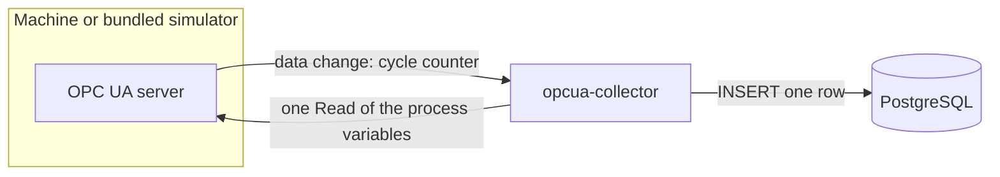
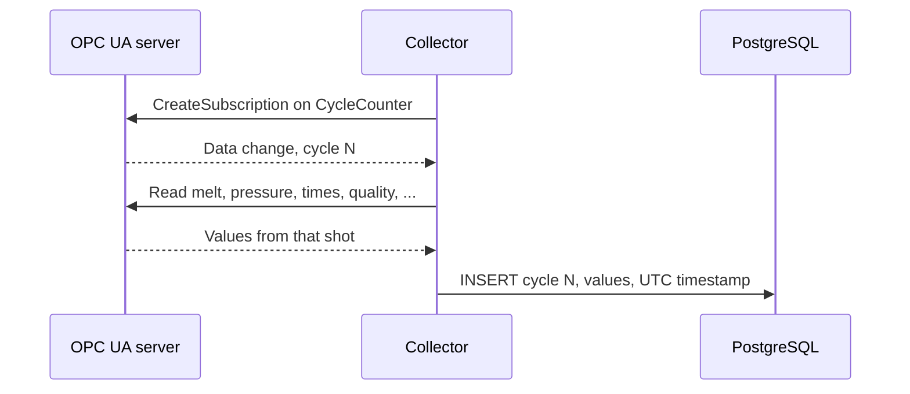

# OPC UA Cycle Collector

[](https://github.com/Urbano1897/ColetorOPCua/actions/workflows/ci.yml)

An event-driven collector that subscribes to a machine cycle counter over OPC UA and writes **one PostgreSQL row per cycle**. It is meant for discrete machines (a molding press, a press brake, a machining center) where the useful record is the finished shot, not a stream of polls.

The repository name, ColetorOPCua, is Portuguese for "OPC UA collector".

A bundled simulator publishes a fictional thermoplastic molding cell, so the whole path runs on a laptop with `docker compose up`. No plant network, no real controller, and no secrets in the repository.

## What it does

- Subscribes to one configurable trigger node (the cycle counter).
- On every change, reads a configurable list of process variables in a single OPC UA `Read`.
- Inserts one row: timestamp, cycle number, and every signal. A bad signal becomes `NULL`; the shot is still stored.
- Creates the table from the config, and adds columns when you add signals later.
- Reconnects to OPC UA with exponential backoff, and retries PostgreSQL without dropping the shot it already read.
- Shuts down on `SIGINT` / `SIGTERM`: unsubscribe, close the session, close the database.

## Why the cycle counter

On a cyclic machine the counter changes once, after the shot is finished, when the values that describe that shot are stable. A timer either stores the same shot twice or cuts across two shots. Subscribing to the counter and then reading the process variables in one call keeps the row internally consistent.

The simulator writes the snapshot nodes first and the counter last, for the same reason: the data change is the signal that the shot is complete.

## Architecture





The subscription is consumed as an async iterator. Notifications are queued on their own task, so a slow `INSERT` cannot stall the OPC UA publish loop. Reading other nodes from inside the data-change callback is a classic way to deadlock this stack; this program does not do that.

## Quick start

Docker Compose runs PostgreSQL, the simulator, and the collector.

```bash
docker compose up --build
```

The simulator finishes a shot every 4 seconds (the recorded cycle time is still about 17 s; wall-clock time is accelerated). The collector logs one line per stored cycle:

```text
Stored cycle 1
Stored cycle 2
```

In another terminal:

```bash
docker compose exec postgres \
  psql -U collector -d machine_data \
  -c "SELECT cycle_number, melt_temperature, injection_pressure, cycle_time, part_quality
      FROM cycle_samples
      ORDER BY cycle_number;"
```

Ports on the host:

| Port | Process |
| --- | --- |
| 4840 | Simulator. From the host, use `opc.tcp://127.0.0.1:4840/industrial/simulator`. |
| 5432 | PostgreSQL, database `machine_data`, user and password `collector`. |

Those credentials exist only for this local stack. Do not reuse them.

Stop with `Ctrl-C`, or `docker compose down` when you started it detached. `docker compose down -v` also drops the database volume.

## Run it without Docker

Requires Python 3.11+ and a PostgreSQL you can create a database on.

```bash
python -m venv .venv
source .venv/bin/activate
pip install -e ".[dev]"
cp .env.example .env
cp config.example.yaml config.yaml
```

Edit `.env` so `DATABASE_URL` points at your database. Then, in two terminals:

```bash
opcua-simulator
opcua-collector --config config.yaml
```

`opcua-simulator` defaults to `opc.tcp://127.0.0.1:4840/industrial/simulator`, which is what `config.example.yaml` expects. The seed defaults to `0`, so the same demo produces the same shots.

## Configuration

Copy `config.example.yaml`. Secrets are environment variables named by the file, never values in the file. The collector loads a `.env` in the working directory and does not override variables that are already set.

### `opcua`

| Field | Meaning |
| --- | --- |
| `endpoint` | `opc.tcp://` URL the client can route to. Inside Compose this is the service name `simulator`, not `127.0.0.1`. |
| `application_uri` | URI sent with the OPC UA session. |
| `username_env`, `password_env` | Names of environment variables. Leave them unset for anonymous access. |
| `timeout_s` | Per-request timeout, seconds. |
| `session_timeout_ms` | Requested session timeout, milliseconds. |
| `publishing_interval_ms` | How often the server may publish the counter. Minimum 50. |
| `reconnect.initial_s`, `max_s`, `multiplier` | Backoff after the session drops. First wait is `initial_s`, then it grows up to `max_s`. |

### `database`

| Field | Meaning |
| --- | --- |
| `dsn_env` | Environment variable holding a `postgresql://` URL. Default name: `DATABASE_URL`. |
| `table` | Table to create. Lowercase SQL identifier. |
| `timestamp_column` | UTC time the collector read the shot. |
| `reconnect` | Backoff used while a shot is waiting to be written. The OPC UA session stays up. |

### `trigger`

| Field | Meaning |
| --- | --- |
| `node_id` | OPC UA node id, for example `ns=2;s=Machine.CycleCounter`. |
| `column` | Integer column that stores the new counter value. |

The first notification after subscribe is the counter's current value, so the collector stores whatever shot is already published, then one row per later change. The same cycle is not stored twice by one process. A restart can store the current cycle one extra time. A counter that moves backwards (a reset) is stored and logged.

### `nodes`

Each entry is one column.

| Field | Meaning |
| --- | --- |
| `node_id` | OPC UA node id. |
| `column` | Lowercase identifier: letters, digits, underscores, at most 63 characters. `id` is reserved. |
| `type` | `integer`, `float`, `boolean`, or `string`. |
| `unit` | Optional. Stored in the column comment, for example `°C` or `MPa`. |
| `description` | Optional. Stored in the column comment. |

Column names are checked against that pattern and then quoted. A typo cannot become SQL.

Unknown keys are rejected, so a misspelled field fails at startup instead of being ignored.

### Simulator

The simulator is a generic molding cell, not a model of any real press. Namespace `urn:opcua-collector:simulator` is index 2. The default snapshot is the node list in `config.example.yaml`.

Three more nodes move during the shot and are not collected by default. Browse them with any OPC UA client:

| Node id | What it does |
| --- | --- |
| `ns=2;s=Machine.State` | `idle`, `mold_close`, `inject`, `hold`, `cool`, `mold_open`, `eject` |
| `ns=2;s=Machine.ScrewPosition` | Live screw position, 0 mm fully forward |
| `ns=2;s=Machine.HydraulicPressure` | Live hydraulic pressure |

| Variable | Default | Meaning |
| --- | --- | --- |
| `SIM_ENDPOINT` | `opc.tcp://127.0.0.1:4840/industrial/simulator` | URL the server advertises. It listens on all interfaces when the host is not localhost, which is what Compose needs. |
| `SIM_CYCLE_PERIOD_S` | `5` | Accelerated wall-clock length of one shot. Minimum 0.5. Compose uses 4. |
| `SIM_SEED` | `0` | Seed for the process model. |

Recorded process values stay in a normal band for this fictional cell: melt around 220 °C, mold around 45 °C, injection around 110 MPa, shot volume around 42 cm³, clamp force around 900 kN, cycle time around 17 s. Every 17th shot is held for review (low cushion). Every 37th, 41st, and 53rd is scrap: a cold melt, a short shot, or a pressure spike. `alarm_active` is true only for scrap.

## What gets stored

```text
cycle_samples
  id                 bigint identity
  sampled_at         timestamptz   not null   -- collector clock, UTC
  cycle_number       bigint        not null   -- the trigger
  melt_temperature   double precision
  ... one column per configured signal, nullable
```

Indexes on `sampled_at` and `cycle_number` are created with the table. Adding a signal to the config adds a nullable column on the next startup. Columns you remove from the config are left in place, so a typo cannot drop history. Changing a column's type is a manual migration.

A signal with a bad OPC UA status, or a value that cannot be converted, is stored as `NULL` and logged. The rest of the shot is kept. If the whole read fails because the session died, nothing is inserted and the collector reconnects; the server republishes the current counter.

PostgreSQL errors that mean "the connection is dead" are retried with the database backoff. The shot stays in memory, and newer cycles wait in the subscription queue. That queue is not a durable spool: a crash, or a counter that moves on while the collector is disconnected, keeps the latest cycle and loses the ones in between. See the roadmap.

Logs are JSON on stderr (`LOG_FORMAT=text` if you want a single readable line). `LOG_LEVEL=DEBUG` also prints the values of each shot. The OPC UA library is kept at warning, because it logs every publish.

## Sample

`SIM_SEED` defaults to 0, so a fresh stack produces these shots. This is the output of the query below after `docker compose up --build`, once six cycles had been stored. The collector subscribed while shot 1 was already the current value, so the table starts at cycle 1. Connect before the first shot finishes and you also get cycle 0: heaters at setpoint, pressure 0, `part_quality` `idle`.

```sql
SELECT cycle_number,
       melt_temperature,
       injection_pressure,
       cycle_time,
       part_quality
FROM cycle_samples
ORDER BY cycle_number
LIMIT 6;
```

```text
 cycle_number | melt_temperature | injection_pressure | cycle_time | part_quality
--------------+------------------+--------------------+------------+--------------
            1 |           220.46 |             107.43 |      17.27 | good
            2 |           219.81 |             109.69 |      17.35 | good
            3 |           221.24 |              109.7 |       17.3 | good
            4 |           220.36 |             107.47 |      17.75 | good
            5 |           220.61 |             109.02 |      17.47 | good
            6 |           221.18 |             110.04 |      17.39 | good
```

A scrap shot looks like this (cycle 37 is the cold-melt disturbance):

```sql
SELECT cycle_number, melt_temperature, part_quality, alarm_active
FROM cycle_samples
WHERE part_quality <> 'good';
```

## Development

```bash
pip install -e ".[dev]"
ruff check src tests
ruff format --check src tests
pytest
```

CI on GitHub Actions runs that on Python 3.11 and 3.12.

Tests cover config parsing, value conversion, the SQL column contract, the process model, and the real trigger path: an in-process OPC UA server changes the counter, the collector batch-reads the nodes (including one that does not exist), and a stand-in for PostgreSQL records the row. A failing insert is retried without dropping the shot. The simulator test checks that a completed shot increments the counter.

## Project layout

```text
src/opcua_collector/            collector, config, PostgreSQL writer
src/opcua_collector/simulator/  OPC UA server and the fictional press
config.example.yaml             copy this
deploy/config.docker.yaml       the same signals, Compose DNS name
docker-compose.yml              postgres + simulator + collector
tests/                          pytest
.github/workflows/ci.yml        ruff and pytest
```

## Roadmap

- OPC UA `SignAndEncrypt`, with application certificates.
- A durable spool, so shots that happen while PostgreSQL is down are forwarded later instead of being skipped.
- More than one machine in one process.
- Optional TimescaleDB hypertable and a retention policy.
- Metrics: connection state, last cycle, insert latency.
- A small Grafana dashboard on top of `cycle_samples`.

## Security

The Compose file uses the password `collector` for a database that only exists on your machine. The simulator allows anonymous, unencrypted OPC UA. Neither belongs on a plant network.

The YAML file cannot hold a password. Username and password, when you need them, come from `OPCUA_USERNAME` and `OPCUA_PASSWORD`. Without a secure channel they are not protected in transit. Point the collector at a server you trust, and treat certificate support as future work rather than something this version provides.

Database errors are logged with the password redacted. The endpoint URL is logged without userinfo.

## License

[MIT](LICENSE).
